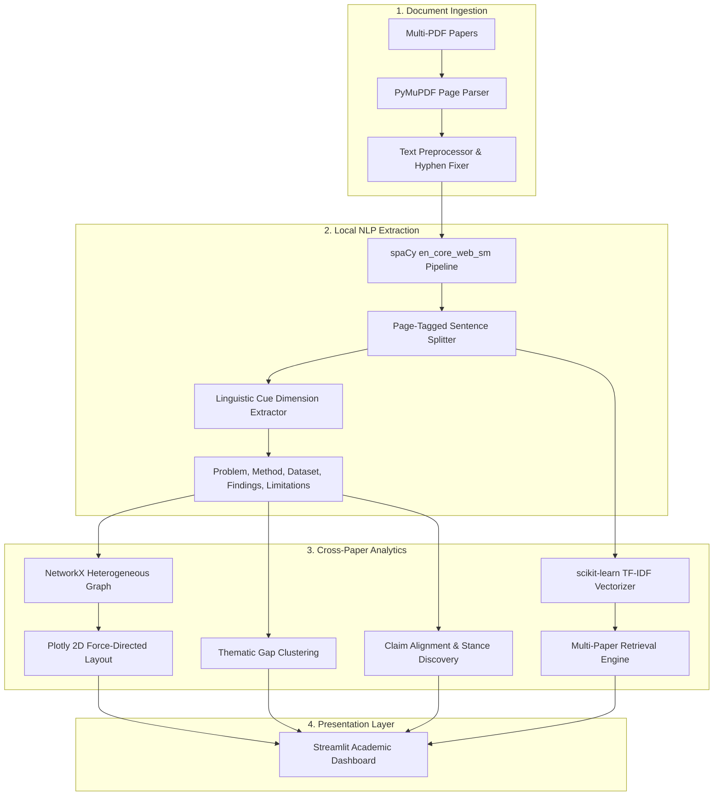

# LitSense — Intelligent Literature Review and Research Gap Discovery

**LitSense** is an academic literature review and research gap discovery platform built with Python, Streamlit, and local NLP. Designed for researchers and students, it extracts multi-paper dimensions, clusters explicit author-stated limitations into candidate open research gaps, visualizes evidence-linked knowledge graphs, and performs evidence-grounded passage retrieval with page-level citation provenance.

---

## 🏛️ System Architecture



---

## ✨ Primary Features

| Feature | Description | Key Modules |
| :--- | :--- | :--- |
| **🏢 Multi-Paper Workspace** | Batch upload PDFs, extract text with PyMuPDF, preserve page numbers, and diagnose unreadable/scanned PDFs. | `processor.py` |
| **📊 Systematic Comparison Matrix** | Side-by-side comparison across 6 dimensions: Problem, Methodology, Datasets, Findings, Limitations, and Future Work. | `processor.py` |
| **🔍 Research Gap Explorer** | Groups limitation and future-work statements into thematic clusters using TF-IDF and cosine similarity. Distinguishes explicit author statements from inferred gaps. | `gap_analyzer.py` |
| **🕸️ Evidence Knowledge Graph** | Interactive Plotly network modeling Papers, Methods, Datasets, and Constraints with supporting evidence drawer and network metrics. | `knowledge_graph.py` |
| **💬 Ask the Literature** | Search across all uploaded papers using scikit-learn TF-IDF. Displays ranked passages with exact page citations and zero hallucination. | `search_engine.py` |
| **⚖️ Claim Alignment** | Baseline lexical-semantic stance analysis to discover related cross-paper claims, potential concordance, and differing perspectives. | `gap_analyzer.py` |
| **📚 NLP Methodology** | In-app viva documentation detailing every library, pipeline step, heuristic rule, and design trade-off. | `app.py` |

---

## 🚀 Setup & Installation (Windows PowerShell)

### Prerequisites
- Python 3.10 – 3.14 installed
- Git installed

### 1. Clone the Repository
```powershell
git clone https://github.com/Riddhi875/Research-Paper-Intelligence.git
cd Research-Paper-Intelligence
```

### 2. Create and Activate Virtual Environment (Recommended)
```powershell
python -m venv .venv
.\.venv\Scripts\Activate.ps1
```

### 3. Install Dependencies
```powershell
pip install -r requirements.txt
```

### 4. Run Unit Tests
```powershell
python -m unittest tests/test_litsense.py
```

### 5. Launch LitSense Application
```powershell
streamlit run app.py
```
The app will open automatically in your browser at `http://localhost:8501`.

> **Viva Demo Tip:** In the sidebar, click **"Load 3 Demo Academic Papers"** to instantly populate the application with pre-extracted NLP research papers (Transformers, FlashAttention, and Longformer) for an immediate demonstration.

---

## 🔬 NLP Methodology Explained

1. **PDF Text Extraction**: Uses `pymupdf` (MuPDF C-library bindings) to extract native text streams page-by-page. Empty text layers are flagged as scanned/image-based documents requiring OCR.
2. **Text Cleaning**: Normalizes irregular horizontal whitespace, standardizes multi-newlines, and rejoins broken hyphenated words (`transfor-\nmer` → `transformer`).
3. **Sentence Segmentation**: Employs spaCy's dependency-based sentence boundary detector (`en_core_web_sm`) to handle academic abbreviations and citations cleanly.
4. **Dimension Extraction**: Uses weighted multi-word linguistic cue patterns (e.g., *"we address the problem"*, *"our approach fails when"*, *"consistently outperforms"*) mapped to academic dimensions with verbatim excerpts and page tags.
5. **Search & Information Retrieval**: Fits a `TfidfVectorizer` (sublinear term weighting, unigram+bigram tokenization) across the entire corpus. Ranked retrieval calculates vector cosine similarity against query vectors.
6. **Gap Discovery**: Clusters cross-paper limitation and future-work statements into convergent problem spaces using pairwise cosine similarity thresholding (`>= 0.20`).
7. **Knowledge Graph**: Models heterogeneous academic entities (Papers, Methods, Datasets, Limitations) in a NetworkX graph with degree centrality metrics and Plotly interactive rendering.

---

## 🎓 Viva Defense Q&A Cheatsheet

**Q1: Why did you not use an external LLM API (like GPT-4) for question answering?**
> *Answer:* Literature reviews demand verifiable provenance and zero hallucinations. Commercial APIs can invent citations or hallucinate claims. LitSense guarantees 100% extractive traceability to the source page, operates completely free offline, and preserves user data privacy.

**Q2: What is the difference between explicit limitations and system-inferred gaps?**
> *Answer:* Explicit limitations are statements directly written by the authors in the paper (e.g., *"our approach fails on long sequences"*). Inferred candidate gaps are cross-paper clusters where multiple independent papers converge on the same bottleneck or leave an open direction unaddressed.

**Q3: How does LitSense handle scanned or image-based PDFs?**
> *Answer:* `processor.py` inspects the character density of each page. If character count is near zero, it marks the document status as *"Scanned / OCR Needed"* and alerts the user rather than failing silently.

---

## ⚠️ Known Limitations & Future Scope

- **OCR for Scanned Documents**: Native PyMuPDF text extraction requires digital text layers. Future versions can incorporate Tesseract OCR or EasyOCR for image-scanned papers.
- **Natural Language Inference (NLI)**: Current claim alignment uses lexical stance heuristics. Integrating a local transformer cross-encoder (e.g., `DeBERTa-v3-NLI`) would allow formal entailment vs. contradiction verification.
- **Dense Embeddings**: Integrating small local dense embeddings (e.g., `sentence-transformers/all-MiniLM-L6-v2`) will capture deeper semantic synonyms.

---

## 🌐 Deployment to Streamlit Community Cloud

1. Push your clean repository to GitHub:
   ```powershell
   git add .
   git commit -m "Implement LitSense V1: multi-paper workspace, gap discovery, and knowledge graph"
   git push origin main
   ```
2. Visit [share.streamlit.io](https://share.streamlit.io).
3. Connect your GitHub repository:
   - **Repository:** `Riddhi875/Research-Paper-Intelligence`
   - **Branch:** `main`
   - **Main file path:** `app.py`
4. Click **Deploy**. Streamlit Cloud will automatically install dependencies from `requirements.txt`.
